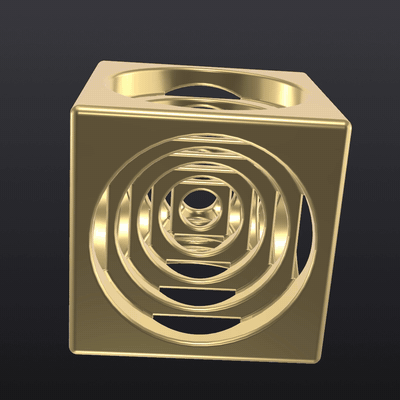
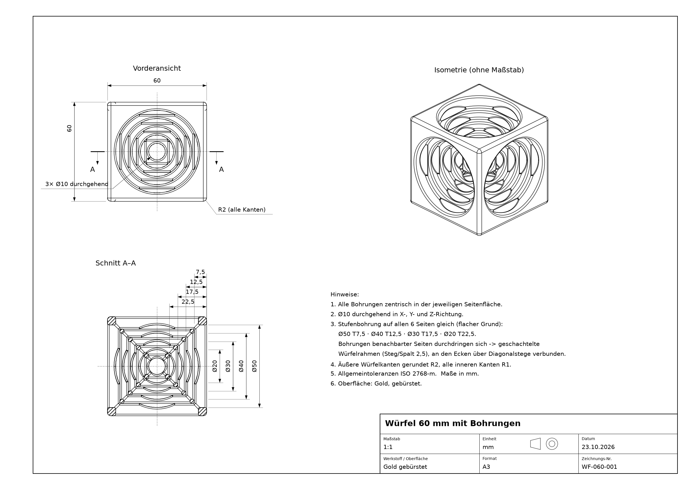
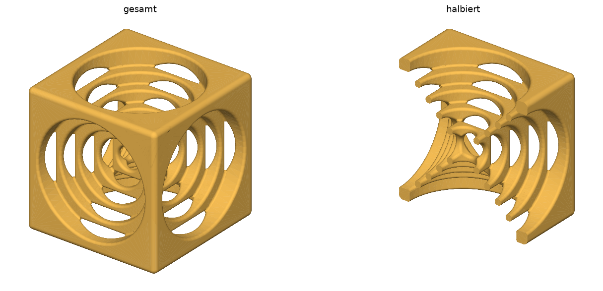

# Nested Gold Cube

A parametric CAD model of a 60 mm cube. Stepped bores on all six faces go deep enough that the bores of adjacent faces cut into each other. What remains are four nested cube frames around a small core cube. The frames are joined to each other by struts along the space diagonals, and the result is a single connected solid.



Full video: [wuerfel_rotation.mp4](wuerfel_rotation.mp4) (60 s, 1920×1080, 30 fps). The cube rotates about X, Y and Z at the same time and the video loops seamlessly.

## Geometry

| Feature | Value |
|---|---|
| Cube edge length | 60 mm |
| Outer edge radius | R2 |
| Inner edge radius (all sharp inner edges) | R1 |
| Through bores along X, Y and Z | Ø10 |
| Stepped bore, identical and centred on all 6 faces | Ø50 × 7.5 · Ø40 × 12.5 · Ø30 × 17.5 · Ø20 × 22.5 |
| Nested frames (outer size) | 60 · 45 · 35 · 25 · 15 mm |
| Inner frame bar thickness / gap between frames | 2.5 mm / 2.5 mm |

The bore depths are derived from a single parameter, `STEG`, in `wuerfel.py`. Each step's floor sits `STEG` outside the radius of the next smaller bore, so the floor becomes the face of the next inner cube. The diameters grow in 5 mm steps, so `STEG` sets the bar thickness and the gap is 5 − `STEG`.

## Technical drawing

The drawing is A3 landscape at 1:1 scale, in first-angle projection. It has a front view, section A–A and an isometric view ([PDF](wuerfel_zeichnung.pdf)).



## Preview



## Files

| File | Content |
|---|---|
| `wuerfel.stl` | Binary STL, closed and manifold (0.02 mm chord tolerance) |
| `wuerfel.step` | Exact B-rep for further CAD work |
| `wuerfel_gold.glb` | glTF with PBR brushed-gold material (metallic 1.0, roughness 0.35, `KHR_materials_anisotropy`) |
| `wuerfel_zeichnung.pdf` / `.png` | Technical drawing |
| `wuerfel_vorschau.png` | Shaded preview |
| `wuerfel_rotation.mp4` / `.gif` | Rotation video and GIF preview |
| `prompt.md` | Specification (German) that reproduces the model in one pass |

The brushed effect in the GLB needs a viewer that supports `KHR_materials_anisotropy`, such as Blender or three.js. macOS Preview shows plain gold.

## Build

Requires Python 3.12. Run the scripts from the repository root.

```sh
python3 -m venv .venv
.venv/bin/pip install build123d matplotlib pyvista imageio imageio-ffmpeg

.venv/bin/python wuerfel.py                        # build model, print validity and solid count
.venv/bin/python export.py                         # STL, STEP, GLB
.venv/bin/python zeichnung.py                      # technical drawing (PDF + PNG)
.venv/bin/python vorschau.py wuerfel_vorschau.png  # shaded preview
.venv/bin/python video.py                          # 60 s rotation video (~2 min); --test renders 3 stills
```

To rebuild the GIF from the video:

```sh
ffmpeg -i wuerfel_rotation.mp4 -vf "setpts=PTS/10,fps=15,crop=1080:1080:420:0,scale=400:-1:flags=lanczos,split[a][b];[a]palettegen=max_colors=128[p];[b][p]paletteuse=dither=bayer:bayer_scale=4" -loop 0 wuerfel_rotation.gif
```
